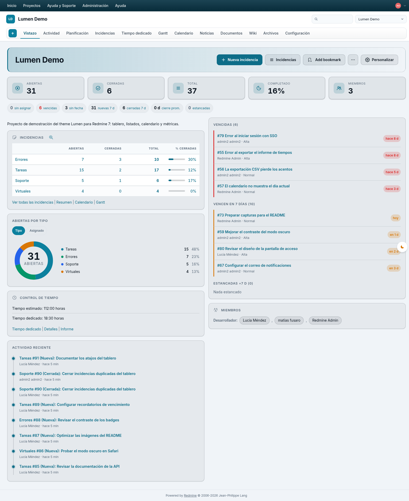
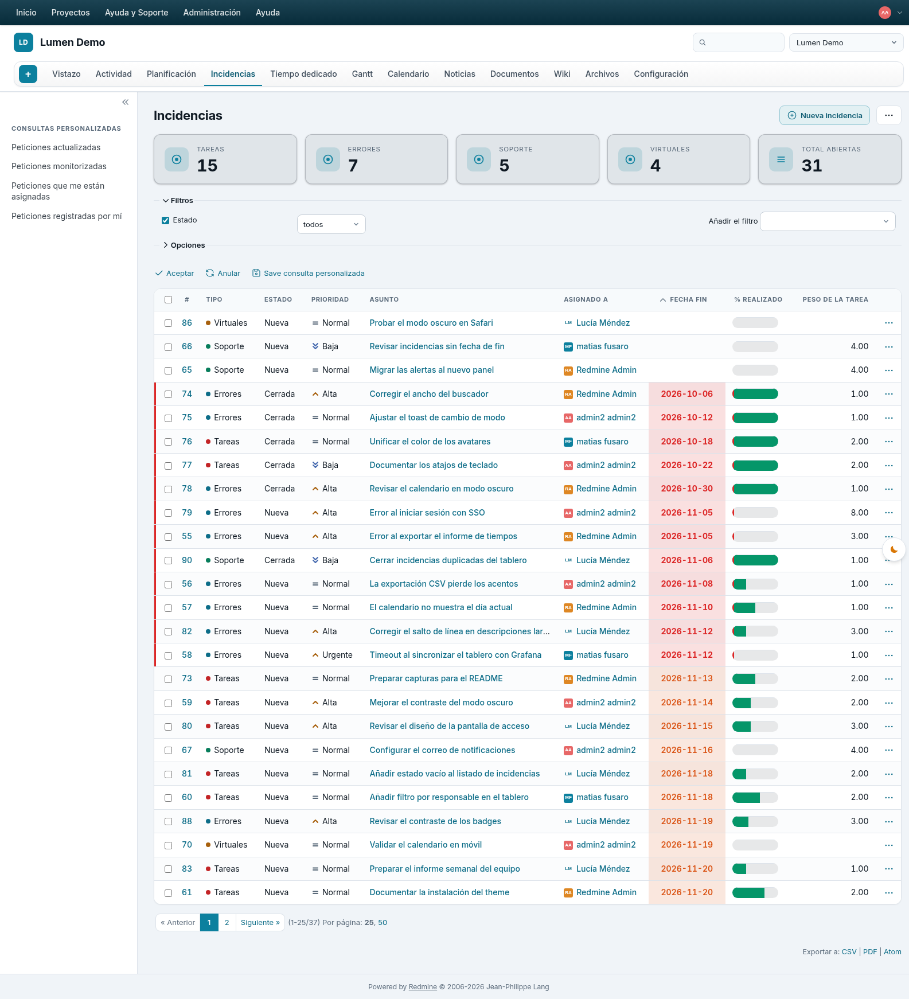
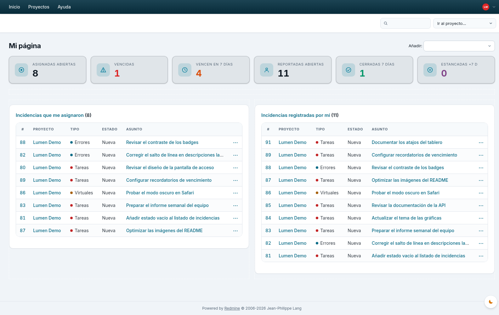
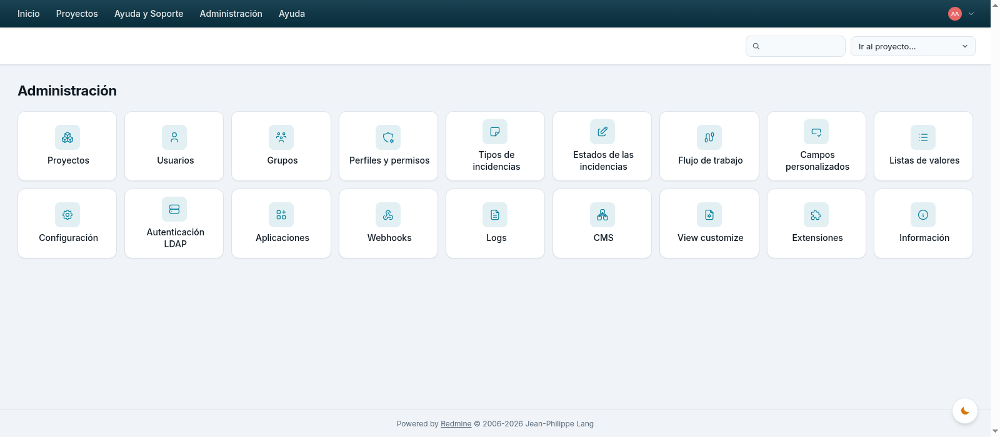
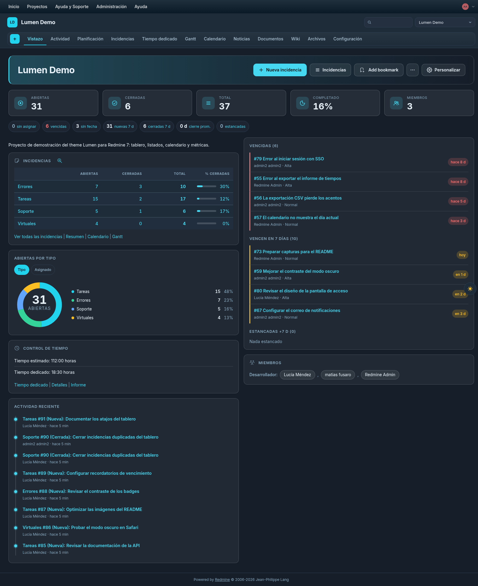
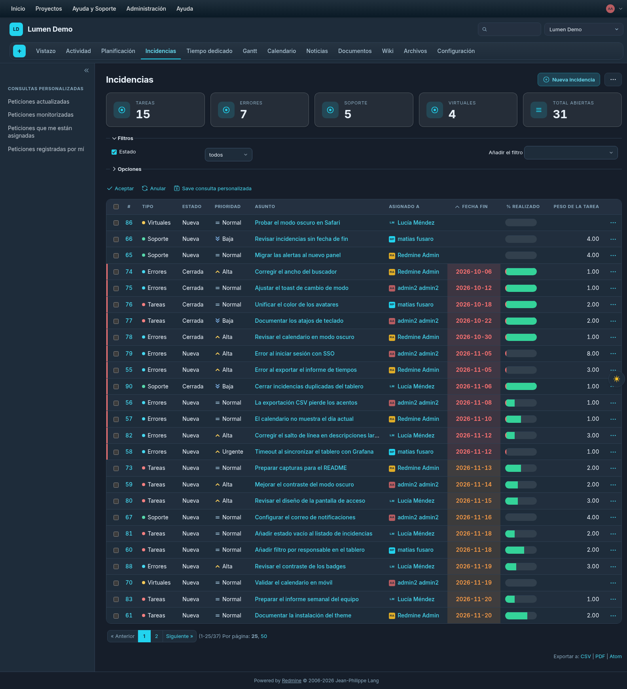
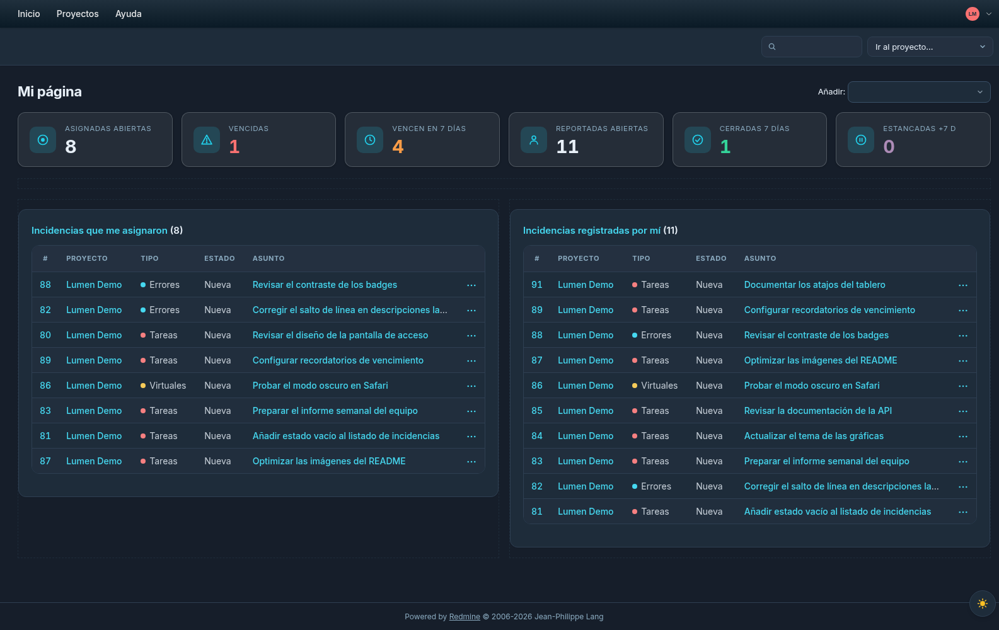
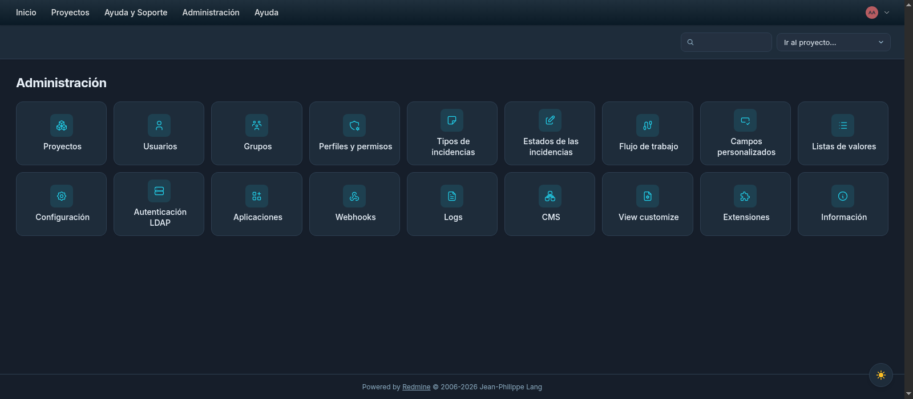

# Lumen — un theme moderno para Redmine 7

Un theme limpio y moderno para **Redmine 7** con modo oscuro, 27 paletas incluidas (y
cualquiera de las ~1.250 paletas de Gogh), barra lateral a izquierda o derecha, tokens de
diseño e interfaz traducida.

Lumen es un fork comunitario de
[`acosonic/redmine-modern-theme`](https://github.com/acosonic/redmine-modern-theme)
(rama `redmine-7`). Mantiene el sistema de diseño original y agrega tableros de proyecto,
métricas en listados, avatares con iniciales, compatibilidad con plugins y textos en
inglés y español.

- **Versión actual:** `1.8.1`
- **Redmine:** 7.0 o superior
- **Licencia:** MIT
- **Carpeta del theme:** `redmine-lumen`

> El fork anterior para Redmine 6 (`redmine-modern-theme-mf`) es un proyecto aparte y no
> es necesario. Lumen se puede instalar junto a él.

## Capturas

Tomadas del proyecto **Lumen Demo** en Redmine 7.0.3, con la columna de Peso de la Tarea
visible en el listado. Hacé clic en una imagen para verla en tamaño completo.

| Vistazo del proyecto | Listado de incidencias |
| --- | --- |
| [](screenshots/overview-light.png) | [](screenshots/issues-light.png) |
| **Mi página** | **Administración** |
| [](screenshots/my-page-light.png) | [](screenshots/admin-light.png) |

<details>
<summary>Modo oscuro</summary>

| Vistazo del proyecto | Listado de incidencias |
| --- | --- |
| [](screenshots/overview-dark.png) | [](screenshots/issues-dark.png) |
| **Mi página** | **Administración** |
| [](screenshots/my-page-dark.png) | [](screenshots/admin-dark.png) |

</details>

## Características

### Theme

- Modo claro/oscuro que sigue al sistema hasta que elegís, y después recuerda tu elección
  por navegador, sin destello al cargar.
- 27 paletas de [Gogh](https://github.com/Gogh-Co/Gogh) con contraste WCAG AA, más
  búsqueda en las ~1.250 paletas.
- Barra lateral a izquierda o derecha y ancho adjustable (180–360 px) en **Mi cuenta**.
- Barra superior, cabecera y pestañas de proyecto fijas en escritorio; la barra lateral
  alta scrollea con la página en vez de crear un segundo scroll.
- Flechas de prioridad y punto de color por tipo en listados y detalle.
- Resaltado de sintaxis, Gantt y calendario con la paleta activa.
- Listado de proyectos como grilla de tarjetas.
- Secciones plegables de **Subtareas**, **Incidencias relacionadas** y **Observadores**.
- Toasts centrados (`window.rmToast(message, type, duration)`).
- En móviles (menos de 900 px) usa la cabecera y el menú nativo de Redmine 7 con los
  colores del theme.
- Propiedades lógicas para idiomas RTL.
- Fuente Inter autoalojada, sin requests externos.

### Vistazo de proyecto

- Hero con nombre, acciones, marcador y menú del proyecto.
- KPIs: abiertas, cerradas, total, completado y miembros.
- Caja **Atención**: hasta 4 vencidas, 4 por vencer en 7 días y 4 estancadas, con totales.
- Dona de abiertas, alternando **tipo** y **asignado**, debajo de la caja *Incidencias*.
- Chips operativos: sin asignar, vencidas, sin fecha, nuevas 7 días, cerradas 7 días,
  cierre promedio y estancadas.
- Panel **Personalizar** por proyecto: prende/apaga indicadores, listas de atención y
  colores de vencimiento; permite cambiar el umbral de estancadas. Se guarda en
  `localStorage`.

### Listados de incidencias

- Tarjetas con abiertas por tipo arriba de los filtros, más una tarjeta de total.
- Colores de vencimiento: rojo vencida, naranja próximos 7 días, amarillo próximos
  30 días. La barra roja izquierda es solo para vencidas reales (no `behind-schedule`).
- Avatares con iniciales en **Asignado** y **Autor**, usando la paleta nativa
  `avatar-color-<id % 16>` de Redmine; el color coincide con el menú de cuenta.

### Mi página

- Franja de KPIs arriba de los bloques: asignadas abiertas, vencidas, vencen en 7 días,
  reportadas abiertas, cerradas en 7 días y estancadas +7 días.
- Horas registradas esta semana (lunes a domingo) para el usuario logueado, leídas desde el
  CSV de time entries con la sesión actual, respetando proyectos privados. Linkea al
  listado de **time entries** filtrado por usuario y semana.

### Dashboard general (Inicio)

- Vistazo con permisos sobre el texto de bienvenida: usuarios (solo admin), proyectos e
  incidencias visibles, nuevas/cerradas/actualizadas en 7 días, horas registradas, cierre
  promedio y actividad reciente. La tarjeta de usuarios muestra además los usuarios activos
  y los nuevos.
- **“Abiertas por tipo”** volvió como **torta**: top 5 de tipos por abiertas, con **Otros**
  para el resto. Escanea el listado agrupado secuencialmente y está limitado a **1.000
  incidencias abiertas**. Si hay más, aclara que los datos salen de las primeras 1.000 y
  ofrece el link al listado completo.
- La actividad reciente comparte la fila 50/50 debajo de las tarjetas KPI con esta torta.
- Lee las páginas HTML de Redmine con la sesión actual, así el admin ve totales globales,
  los usuarios comunes ven sus proyectos/incidencias visibles y el anónimo solo lo público.
  Sin API key, backend ni requests externos.

### Traducciones

Incluye textos en **inglés** y **español** para las funciones agregadas. El idioma sale de
`<html lang="…">` de Redmine; si no hay tabla, usa inglés. Para agregar un idioma, sumá una
tabla a `RM_I18N` en `javascripts/theme.js`; ver
[`docs/TRANSLATIONS.md`](docs/TRANSLATIONS.md).

### Compatibilidad con plugins

Lumen está probado con los plugins de su instalación de referencia. Aplica la paleta
activa a sus superficies y los mantiene legibles en modo claro y oscuro.

| Plugin | Qué cubre Lumen |
| --- | --- |
| **RedmineUP Agile** | Tablero, columnas de planificación, límites WIP y pantalla completa. |
| **RedmineUP Pins** | Barra de pins, tarjetas y colores del modo oscuro. |
| **Redmineflux Taskboard** | Tablero, tarjetas, menús y listado compacto. |
| **Redmine Task Weight** | Columna y valores de peso en listados, con los estilos de tabla del theme. |
| **RedmineUP Checklists** | Campos de checklist y formulario de alta. |
| **RedmineUP Testcase / Vault** | Barras laterales, filtros, etiquetas y gráficas embebidas. |
| **View Customize** | Bloques de código y snippets personalizados. |

Los plugins que usan las variables `--oc-*` de Redmine suelen heredar la paleta activa.

## Instalación

Cloná el repositorio dentro de `themes/`. La carpeta **debe** llamarse `redmine-lumen`:

```bash
cd /ruta/a/redmine/themes
git clone https://github.com/matbott/redmine-lumen.git redmine-lumen
```

Reiniciá Redmine y elegí
**Administración → Configuración → Mostrar → Tema → redmine-lumen**.

## Actualización

```bash
cd /ruta/a/redmine/themes/redmine-lumen
git pull
```

En producción con assets precompilados, limpiá la caché y recompilá antes de reiniciar:

```bash
docker exec -it <container> /bin/bash -c '
  cd /usr/src/redmine &&
  rm -rf public/assets/* &&
  RAILS_ENV=production bundle exec rake tmp:cache:clear &&
  RAILS_ENV=production bundle exec rake assets:precompile'
docker restart <container>
```

## Requisitos

- Redmine **7.0** o superior.
- Navegador de 2024 o posterior: Lumen usa cascade layers, `color-mix()`,
  `light-dark()`, nesting y `:has()` (Chrome/Edge 123+, Firefox 120+, Safari 17.5+).

## Configuración

- **Modo oscuro/claro:** botón abajo a la derecha en todas las páginas.
- **Paleta:** **Mi cuenta → Paleta de colores**, o la fila de paletas recientes del menú
  de cuenta. El selector completo incluye la búsqueda de Gogh.
- **Barra lateral:** **Mi cuenta → Posición** y **Ancho de la barra lateral**.
- **Tablero del proyecto:** **Vistazo → Personalizar**. Se guarda por proyecto y por
  navegador.
- **Colores de vencimiento:** mismo panel, sección *Colores de vencimiento*. La columna
  Fecha fin tiene que estar visible.
- **Tarjetas del listado:** opción *Tarjetas del listado* en el mismo panel.

## Desarrollo

El theme es CSS y JavaScript plano; Redmine no carga nada de `src/`.

```
stylesheets/application.css   entrada upstream + @import de custom.css
stylesheets/schemes.css       paletas generadas
stylesheets/custom.css        personalizaciones y fixes de plugins
javascripts/theme.js          código upstream + bloques Lumen + traducciones
src/                          helpers locales de build/capturas/seed (no se cargan)
docs/                         notas de desarrollo y traducción
```

Antes de un pull request:

```bash
node --check javascripts/theme.js
```

## Autoría y créditos

- **Theme original:** Aleksandar Pavic
  ([@acosonic](https://github.com/acosonic)), autor del
  [Redmine Cookbook](https://www.packtpub.com/en-us/product/redmine-cookbook-9781785285264).
  Lumen se basa en la rama `redmine-7` de
  [`acosonic/redmine-modern-theme`](https://github.com/acosonic/redmine-modern-theme).
- **Fork Lumen, tablero de proyecto, funciones de listados y traducción al español:**
  Matias Fusaro ([@matbott](https://github.com/matbott)).
- **Colaborador IA:** OpenCode (DeepSeek V4.1 Flash Free) — implementación, pruebas,
  documentación y revisión de traducciones.

Paletas: [Gogh](https://github.com/Gogh-Co/Gogh) (MIT). Fuente:
[Inter](https://rsms.me/inter/) (OFL). Ideas (sin código): flechas de prioridad y puntos
de tipo de Opale, barras degradadas de gitmike.

Hecho con cariño por **matbott & 🤖**

## Licencia

MIT. Ver [`LICENSE`](LICENSE). Se conserva el aviso de copyright original.
