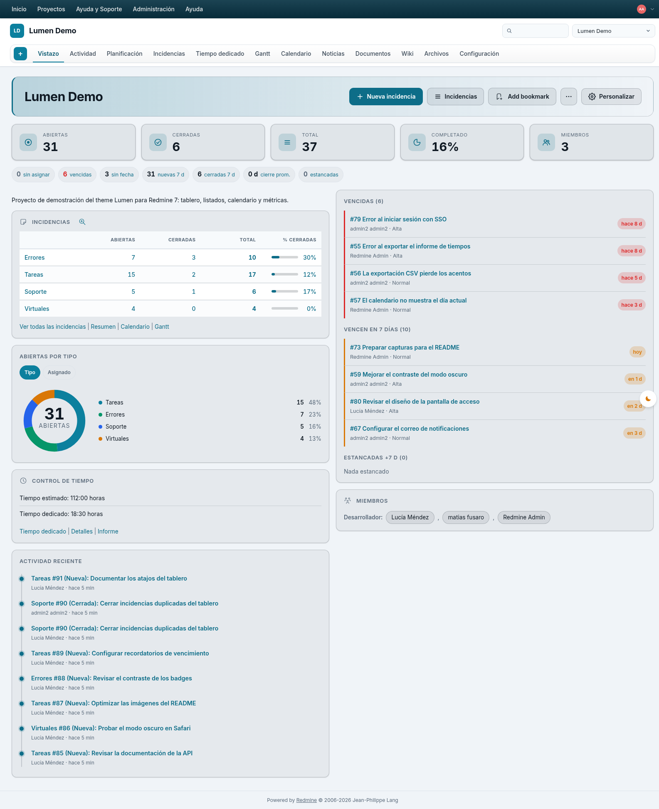
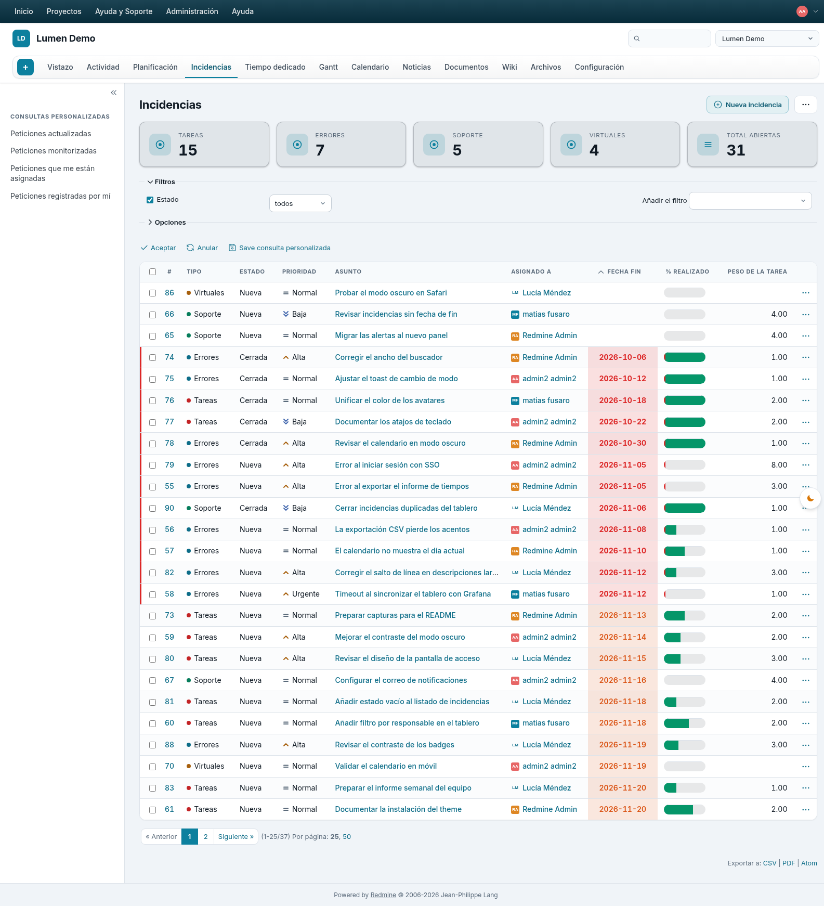
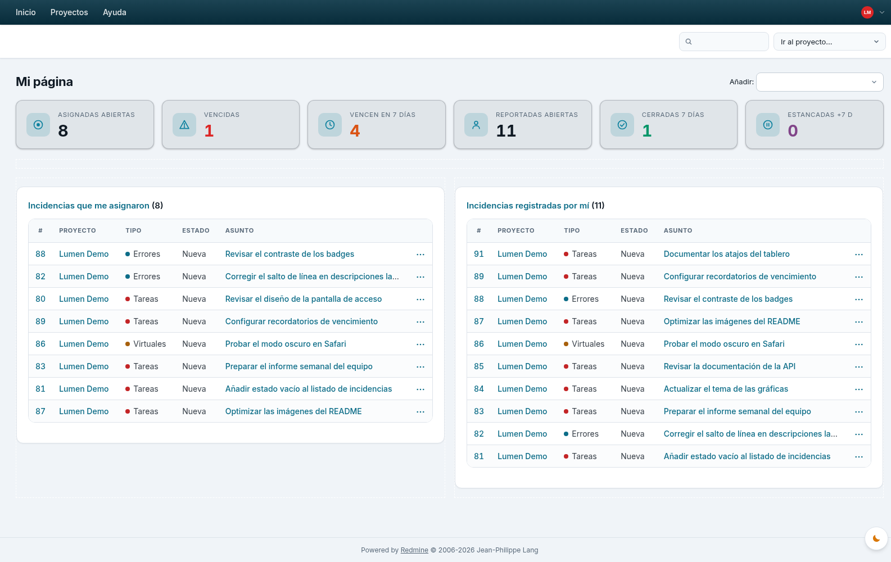
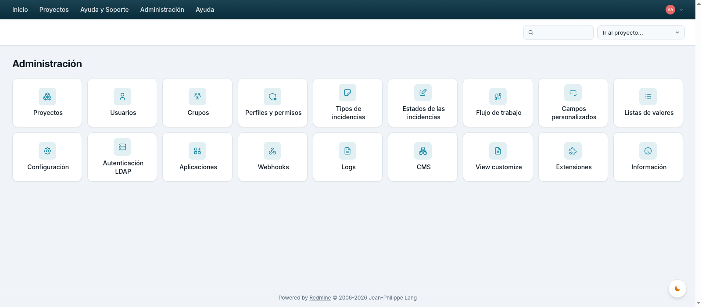
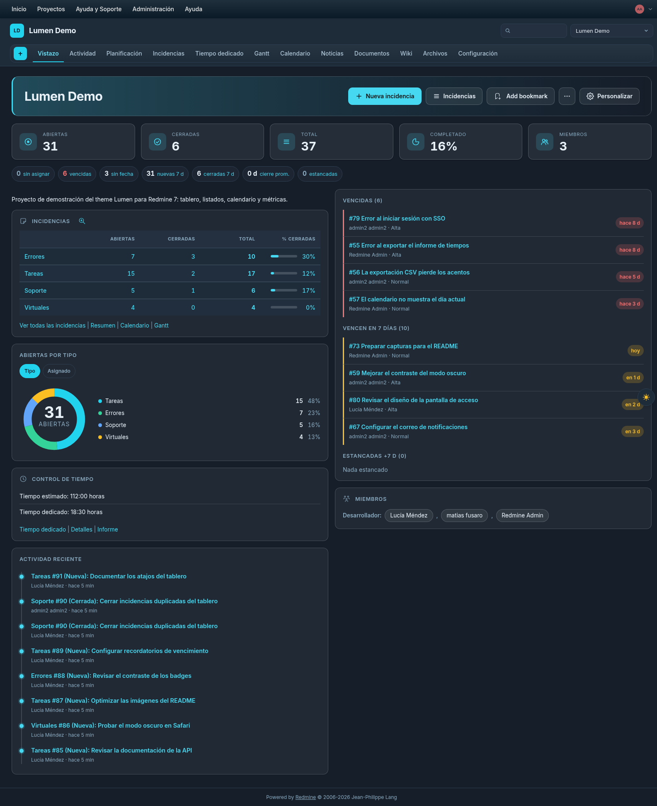
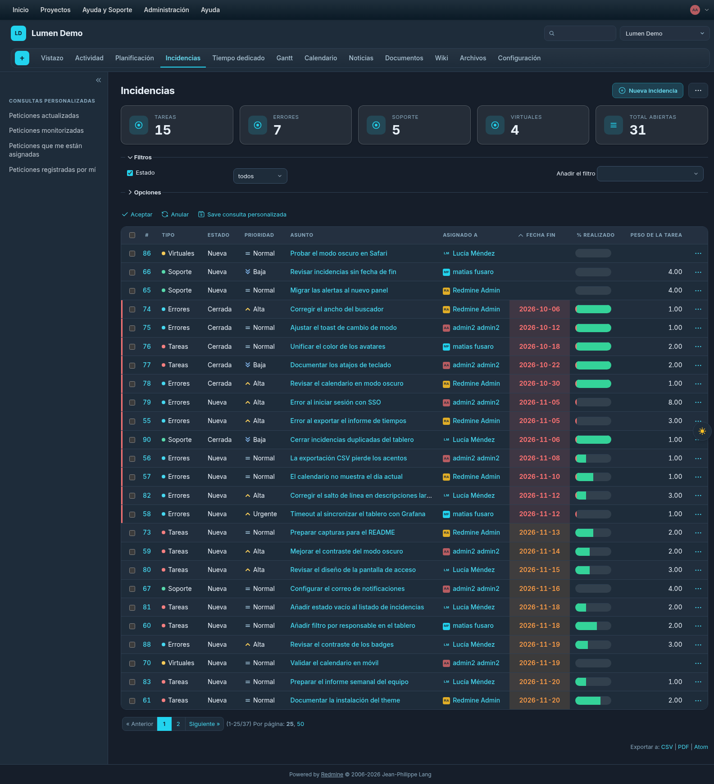
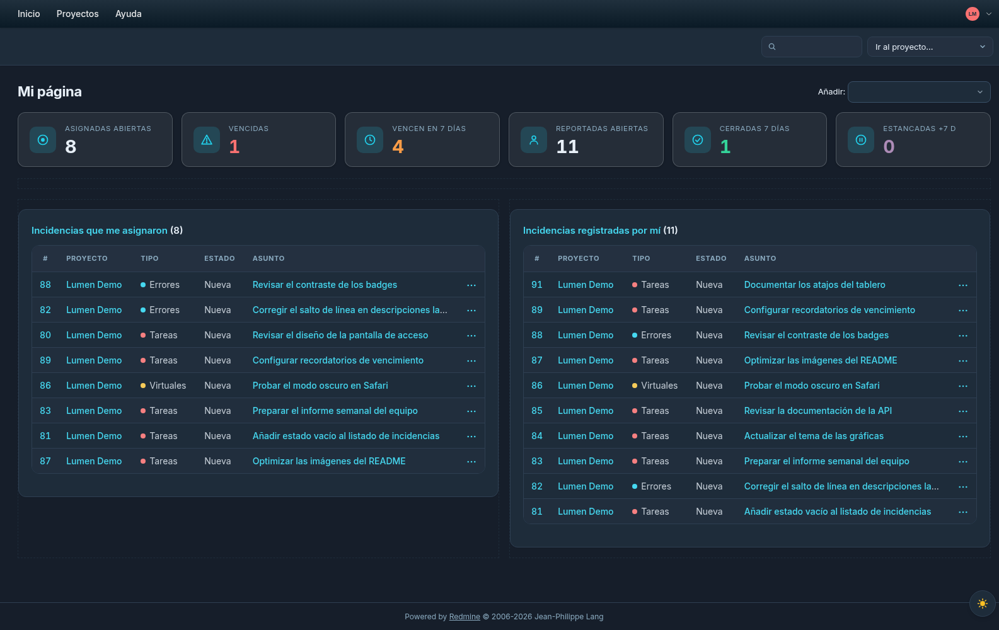
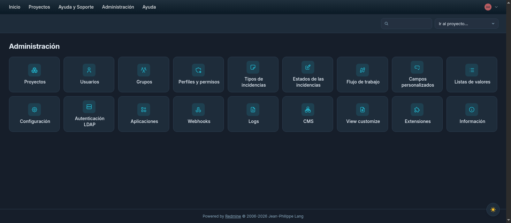

# Lumen — a modern Redmine 7 theme

A clean, modern UI theme for **Redmine 7** with dark mode, 27 built-in colour schemes
(plus any of ~1,250 Gogh palettes), a sidebar on the left or right, design tokens and a
translated interface.

Lumen is a community fork of
[`acosonic/redmine-modern-theme`](https://github.com/acosonic/redmine-modern-theme)
(branch `redmine-7`). It keeps the upstream design system and adds project dashboards,
issue-list metrics, initials avatars, plugin compatibility and English/Spanish UI strings.

- **Current version:** `1.2.4`
- **Redmine:** 7.0 or later
- **License:** MIT
- **Theme folder:** `redmine-lumen`

> The previous Redmine 6 fork (`redmine-modern-theme-mf`) is a separate project and is not
> required. Lumen can be installed alongside it.

## Screenshots

Captured from the **Lumen Demo** project on Redmine 7.0.3, including the Task Weight
column in the issue list. Click an image to open it full size.

| Project overview | Issue list |
| --- | --- |
| [](screenshots/overview-light.png) | [](screenshots/issues-light.png) |
| **My page** | **Administration** |
| [](screenshots/my-page-light.png) | [](screenshots/admin-light.png) |

<details>
<summary>Dark mode</summary>

| Project overview | Issue list |
| --- | --- |
| [](screenshots/overview-dark.png) | [](screenshots/issues-dark.png) |
| **My page** | **Administration** |
| [](screenshots/my-page-dark.png) | [](screenshots/admin-dark.png) |

</details>

## Why Lumen

- **Dark mode that follows the OS** until you choose, then remembers your choice per
  browser, with no flash on load.
- **27 built-in schemes** from [Gogh](https://github.com/Gogh-Co/Gogh) — Dracula, Nord,
  Gruvbox, Catppuccin, Rosé Pine, Tokyo Night, Solarized, GitHub and more — each checked
  for WCAG AA contrast. You can also search all ~1,250 Gogh palettes by name.
- **A sidebar on either side**, with a per-browser width slider on **My account**.
- **Redmine 7 components, not replacements.** The account menu, mobile flyout, sidebar
  collapse and Gantt are core's; Lumen styles them and adds only what core does not have.
- **No backend changes.** Themes are CSS and JavaScript only.

## Features

### Theme

- Light/dark mode, 27 schemes and the full Gogh palette search.
- Sidebar left/right and width (180–360 px), saved per browser.
- Sticky top bar, header and project tabs on desktop; a sidebar taller than the window
  scrolls with the page instead of creating a second scrollbar.
- Priority arrows and a colour dot per tracker in issue lists and on the issue page.
- Syntax highlighting, Gantt bars and the calendar follow the active palette.
- Project list as a left-to-right card grid.
- Collapsible **Subtasks**, **Related issues** and **Watchers** sections.
- Centered toast notifications (`window.rmToast(message, type, duration)`).
- Phones below 900 px use Redmine 7's own header and flyout menu, in theme colours.
- Logical properties throughout, so right-to-left languages mirror as in core.
- Self-hosted Inter font: no external requests.

### Project overview (“Overview hero”)

- Hero with the project name, bookmark/actions menu and primary actions.
- KPI cards: open, closed, total, completion and members.
- **Attention** box: up to four overdue, four due in the next seven days and four stalled
  issues, with running totals.
- Donut chart of open issues, switchable between **tracker** and **assignee**, placed in
  the left column under the *Issues* box.
- Operational chips: unassigned, overdue, no due date, new in 7 days, closed in 7 days,
  average closing time and stalled.
- **Customise** panel per project: toggle every indicator, every attention list and the
  due-date colours; set the stalled threshold. Settings are stored in `localStorage`.

### Issue lists

- KPI cards with open issues by tracker above the filters, plus a total card.
- Due-date colours: red for overdue, orange for the next 7 days, yellow for the next
  30 days. The red left bar is only for truly overdue issues (not `behind-schedule`).
- Initials avatars in the **Assigned to** and **Author** columns, reusing Redmine's own
  `avatar-color-<id % 16>` palette so the colour matches the account menu.

### My page

- A “My overview” KPI strip above the user's blocks: assigned open, overdue, due in
  7 days, reported open, closed in 7 days and stalled for more than 7 days.
- Every card links to the matching filtered issue list for the logged-in user.

### Translations

Lumen ships with **English** and **Spanish** UI strings for the features it adds. The
language is taken from Redmine's `<html lang="…">`, with English as the fallback.

To add a language, add one table to `RM_I18N` in `javascripts/theme.js`. See
[`docs/TRANSLATIONS.md`](docs/TRANSLATIONS.md) for the key list and conventions.

### Plugin compatibility

Lumen is tested against the plugins in its reference Redmine 7 installation. It styles
their surfaces with the active palette and keeps them readable in light and dark mode.

| Plugin | Covered by Lumen |
| --- | --- |
| **RedmineUP Agile** | Board, planning columns, WIP limits and fullscreen mode. |
| **RedmineUP Pins** | Pin toolbar, cards and dark-mode colours. |
| **Redmineflux Taskboard** | Board, task cards, menus and the compact issue list. |
| **Redmine Task Weight** | Weight column and values in issue lists, using the themed table styles. |
| **RedmineUP Checklists** | Checklist fields and the new-item form. |
| **RedmineUP Testcase / Vault** | Sidebars, filters, tags and embedded charts. |
| **View Customize** | Code blocks and custom snippets. |

Other plugins that use Redmine's `--oc-*` variables usually inherit the active scheme
automatically.

## Install

Clone the repository into Redmine's `themes/` folder. The folder name **must** be
`redmine-lumen`:

```bash
cd /path/to/redmine/themes
git clone https://github.com/matbott/redmine-lumen.git redmine-lumen
```

Restart Redmine, then choose
**Administration → Settings → Display → Theme → redmine-lumen**.

## Update

```bash
cd /path/to/redmine/themes/redmine-lumen
git pull
```

In production with precompiled assets, clear the cache and recompile before restarting:

```bash
docker exec -it <container> /bin/bash -c '
  cd /usr/src/redmine &&
  rm -rf public/assets/* &&
  RAILS_ENV=production bundle exec rake tmp:cache:clear &&
  RAILS_ENV=production bundle exec rake assets:precompile'
docker restart <container>
```

## Requirements

- Redmine **7.0** or later.
- A browser from 2024 or later: Lumen uses cascade layers, `color-mix()`,
  `light-dark()`, CSS nesting and `:has()` (Chrome/Edge 123+, Firefox 120+,
  Safari 17.5+).

## Configuration

- **Dark/light mode:** button at the bottom-right of every page.
- **Colour scheme:** **My account → Colour scheme**, or the recent-schemes row in the
  account menu. The full picker includes the Gogh search.
- **Sidebar:** **My account → Sidebar position** and **Sidebar width**.
- **Project dashboard:** **Overview → Customise**. The settings are per project and per
  browser.
- **Issue-list due colours:** the same **Customise** panel, section *Due-date colours*.
  The due-date column must be visible in the list.
- **Issue-list cards:** toggle *Issue list cards* in the same panel.

## Development

The theme is plain CSS and JavaScript; Redmine does not load anything from `src/`.

```
stylesheets/application.css   upstream entry point + @import of custom.css
stylesheets/schemes.css       generated colour schemes
stylesheets/custom.css        Lumen customisations and plugin fixes
javascripts/theme.js          upstream theme code + Lumen blocks + translations
src/                          local build/screenshot/seed helpers (not loaded)
docs/                         development and translation notes
```

Useful checks before opening a pull request:

```bash
node --check javascripts/theme.js
```

Screenshots and probe helpers live in `src/shot.mjs`; they are development tools, not
part of the theme.

## Authors and credits

- **Original theme:** Aleksandar Pavic
  ([@acosonic](https://github.com/acosonic)), author of the
  [Redmine Cookbook](https://www.packtpub.com/en-us/product/redmine-cookbook-9781785285264).
  Lumen is based on the `redmine-7` branch of
  [`acosonic/redmine-modern-theme`](https://github.com/acosonic/redmine-modern-theme).
- **Lumen fork, project dashboard, issue-list features and Spanish translation:**
  Matias Fusaro ([@matbott](https://github.com/matbott)).
- **AI collaborator:** OpenCode (DeepSeek V4.1 Flash Free) — implementation, testing,
  documentation and translation review.

Palettes: [Gogh](https://github.com/Gogh-Co/Gogh) (MIT). Font:
[Inter](https://rsms.me/inter/) (OFL). Ideas (no code): priority arrows and tracker dots
from Opale, gradient bars from gitmike.

Made with care by **matbott & 🤖**

## Licence

MIT. See [`LICENSE`](LICENSE). The original copyright notice is preserved.
